<p align="center">
  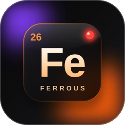
</p>

# Ferrous

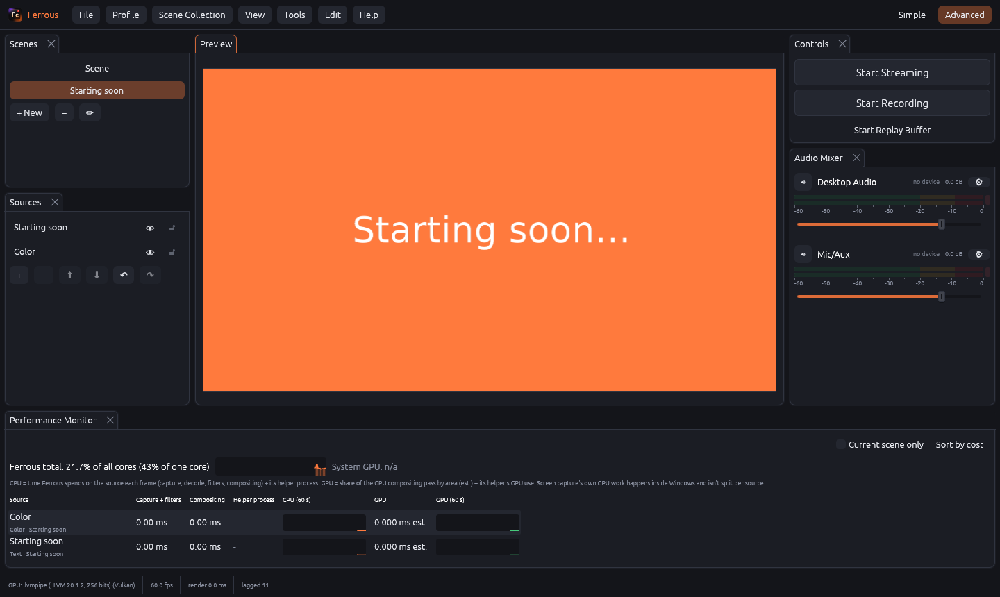

**A lean, fast recording and streaming studio for Windows, written in Rust: a modern successor to OBS Studio.**

## The goal

OBS is the standard, but it spends more CPU, GPU and memory than it needs to, and it makes you hunt
through plugins for things people use every day. Ferrous has one aim: **capture, composite, encode,
record and stream with as little overhead as possible, and still give you the cleanest, smoothest picture
your hardware can produce.** In practice that means:

- **Low resource use first.** A multi-threaded GPU compositor (filters included) with a CPU fallback,
  finished NV12 handed straight to the encoder, optional GPU-resident capture, memoised static scenes, a
  capped window redraw rate, and no work done for windows or previews you aren't looking at. Every feature is judged against its cost.
- **Picture quality you can measure.** Every encoder is tuned (two-pass, lookahead, adaptive
  quantisation, 10-bit internals), HDR10 output is built in, and a built-in benchmark compares
  settings by speed *and* quality (SSIM/VMAF) so you pick settings from evidence, not guesses.
- **The things OBS needs plugins for, built in.** Source clone, undo/redo, track-matte transitions, vertical
  canvas for TikTok/Shorts, Ferrous Link (a LAN video/audio link between PCs), virtual camera, VST3, and
  safe game capture that never injects into a game.
- **Familiar, not foreign.** obs-websocket 5 compatible (Stream Deck, Touch Portal and Streamer.bot work),
  OBS scene-collection import, and an OBS-style Add Source dialog.

> **Status: v0.4, pre-release.** Built and tested on Linux with a Windows cross-build; much of the Windows-only
> code (virtual camera, game capture, VST3 editors, the D3D12/Vulkan encoders, HDR playback) has not yet been
> run on real hardware. Progress, test evidence and deferred items are in [`docs/PROGRESS.md`](docs/PROGRESS.md).

## Highlights

| | |
|---|---|
| **Filters on the GPU** | Chroma key, colour correction, scroll, LUTs and the background-removal mask run as GPU passes in the compositor (shaders compile the first time you use a filter). CPU twins stay as the fallback and are tested to give the same picture. |
| **GPU-resident capture (experimental)** | Settings → Video → *GPU capture*: display, window and game capture hand each frame to the renderer as a shared texture and skip the copy through system memory. Off by default; it falls back to the normal path by itself for plugin filters, background removal, nested scenes, a different GPU or any error. |
| **Sharper downscaling** | Layers shrunk by more than about 1.25:1 (a 4K display on a 1080p canvas) are area-averaged, so fine lines and text stop shimmering. 1:1 and enlarged layers cost nothing extra. |
| **A GPU figure you can trust** | The Performance Monitor reads the card's own utilisation (the same counter RTSS shows) instead of Windows' per-engine counters, which can read far too high. |
| **Window frame rate** | Settings → General: cap Ferrous's own window at 30/60/120/144/240 fps or unlimited, so it doesn't compete with your game for the GPU. Your video's frame rate is unaffected. |
| **Recording presets and a speed/quality benchmark** | Save named recording presets (built-in *Max quality*, *Balanced*, *Light*, *Small files* are generated for your encoders). The benchmark encodes the same footage with each setting, then reports speed, bitrate and quality (SSIM/PSNR, or VMAF if your FFmpeg has it) and flags the best quality, best value and lightest settings that still keep up in real time. |
| **HDR10 output** | SDR sources mapped to 10-bit BT.2020/PQ for HEVC and AV1 (adjustable SDR white level). True HDR capture is planned. |
| **Tuned encoders** | NVENC two-pass and lookahead, H.264 High profile, AV1 10-bit internals, Quick Sync adaptive I/B, AMF VBAQ, SVT-AV1 visual-quality tune. |
| **Safe Game Capture** | Follows your game with Windows Graphics Capture: no DLL injection, so it is anti-cheat safe. |
| **Source Clone and Track Matte** | Reuse a live source without a second capture; stinger-style transitions with a track matte. |
| **Add Source dialog** | OBS 32-style source picker with categories, existing sources and recently used. |
| **Undo/redo, per-scene transitions, projector and multiview windows, audio sync offset** | Everyday tools that are plugins or workarounds in OBS. |

## Features

| Area | What's included |
|---|---|
| **Rendering** | GPU compositor (wgpu: D3D12/Vulkan) with the video filters as GPU passes and a CPU fallback, optional GPU-resident capture, studio mode, transitions (cut, fade, fade-to-colour, swipe, slide, stinger, **27 luma wipes** or your own wipe image), nested scenes, **source clone** (reuse a live source with its own crop and filters, no second capture), **rotation** (antialiased, with an on-canvas rotate handle) |
| **Vertical canvas** | Second 9:16 canvas with its own per-scene layout, for TikTok, Shorts and Reels, alongside the main canvas |
| **Sources** | Display, window, **game capture** (follows your game, no injection) and **application audio** capture; webcams and capture cards; media files and URLs; images; colour; **text** (from file too); **browser** (headless Edge, transparent); **Ferrous Link**; plugin sources; **OBS plugin sources** (run on your OBS install's libobs); test pattern |
| **Filters** | Chroma key, colour correction, scroll, LUT; RNNoise noise suppression, gate, compressor, limiter, gain; **VST3 effects** (generic editor, plus the plugin's own editor window); plugin filters |
| **Audio** | WASAPI desktop and mic plus per-source channels, 6 tracks, monitoring; **OBS-style animated mixer** (stereo peak/RMS meters with peak hold and clip lights, gliding faders, horizontal or vertical layout); volume and mute saved per source |
| **Encoders** | NVENC, AMF, Quick Sync (H.264/HEVC/AV1), **DirectX 12 Video and Vulkan Video** (H.264/HEVC/AV1 on any GPU whose driver supports them), Media Foundation, x264, x265, SVT-AV1, AOM. Every encoder is test-encoded before it's offered. The canvas can be converted to the encoder's YUV format in Ferrous, multi-threaded, before it reaches FFmpeg (62% less data per frame) |
| **Outputs** | Recording (MKV, MP4, fragmented MP4, MOV, TS, FLV; multitrack; separate recording resolution), streaming (RTMP/RTMPS, SRT, WHIP) with auto-reconnect, **multistream destinations**, **replay buffer** (plus a vertical clip), **virtual camera** (Windows 11) |
| **TikTok** | TikTok LIVE preset, per-session key prompt, vertical canvas output, vertical replay clips |
| **Ferrous Link** | obs-teleport successor: LAN discovery on every network adapter, JPEG, lossless+alpha or hardware codecs, adaptive quality, PIN with encryption, live stats |
| **Control** | **Undo/redo** (Ctrl+Z), per-scene transitions, program projector and multiview windows, Global hotkeys, **obs-websocket 5 compatible** API (Stream Deck, Touch Portal, Streamer.bot, TikFinity) |
| **Extensibility** | Native C-ABI plugin system (`docs/PLUGINS.md`); **OBS plugin bridge** for OBS plugin sources (`docs/OBS_PLUGIN_BRIDGE.md`); VST3 |
| **Presets** | **Recording presets** (built-in and your own) and a **speed/quality benchmark** that ranks settings for your PC |
| **Setup** | First-run **benchmark** (encoders, compositor, upload, ingest-server ranking) with separate streaming and recording recommendations; quick auto-config wizard |
| **Organisation** | Profiles, scene collections, **OBS scene-collection import** |
| **Ease of use** | **Simple mode** by default (switch to Advanced any time), empty-state tiles and scene templates, a **pre-flight check** before recording or going live, plain-language errors with fix buttons, Undo toasts, a **Ctrl+K command palette**, a first-run tour and troubleshooting page; accessibility: interface zoom, high-contrast theme, colour-blind meters, reduce motion |
| **UI** | Fully modular docks: every card (preview, scenes, sources, mixer, controls, properties, stats, performance, vertical canvas) can be dragged and snapped beside, above, below or into any other dock with a live snap preview, resized, floated, closed and reopened; layout presets, named saved layouts and a layout lock; **custom browser docks** (chat, alerts, activity feeds as live pages, like OBS); **Stats** dock (choose your stats); **Performance Monitor** (per-source CPU/GPU with graphs); layout remembered between sessions |

## Screenshots

All taken from the current build on a Linux virtual display using a software Vulkan driver, so there are no capture sources or audio devices and the GPU figure reads n/a. Everything shown is the real interface.

| | |
|---|---|
| 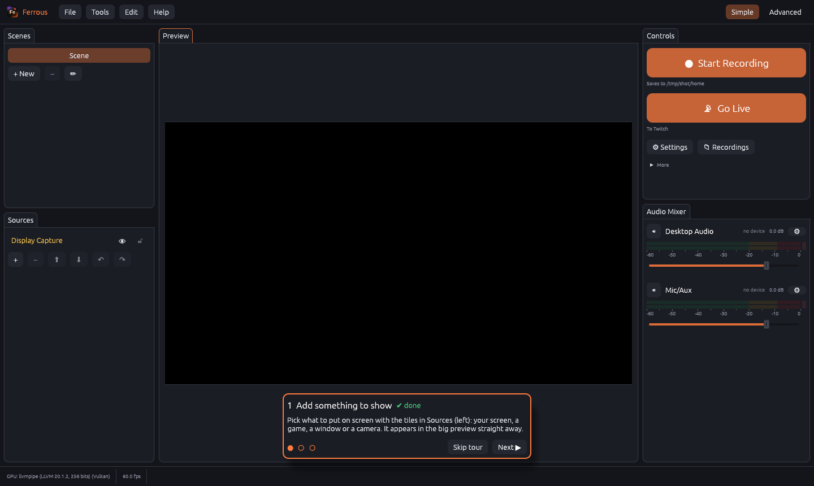 **Simple mode** (the default): scenes, sources, preview, mixer and two big buttons, plus a three-step tour | 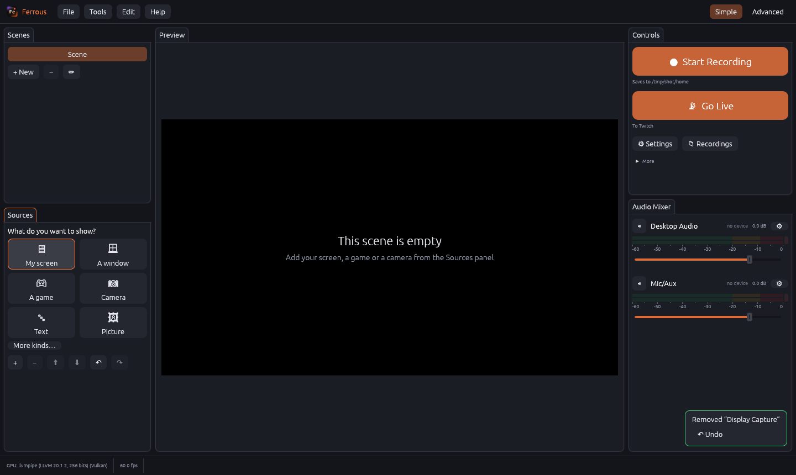 An empty scene offers big tiles instead of a blank list, and removing something offers Undo |
| 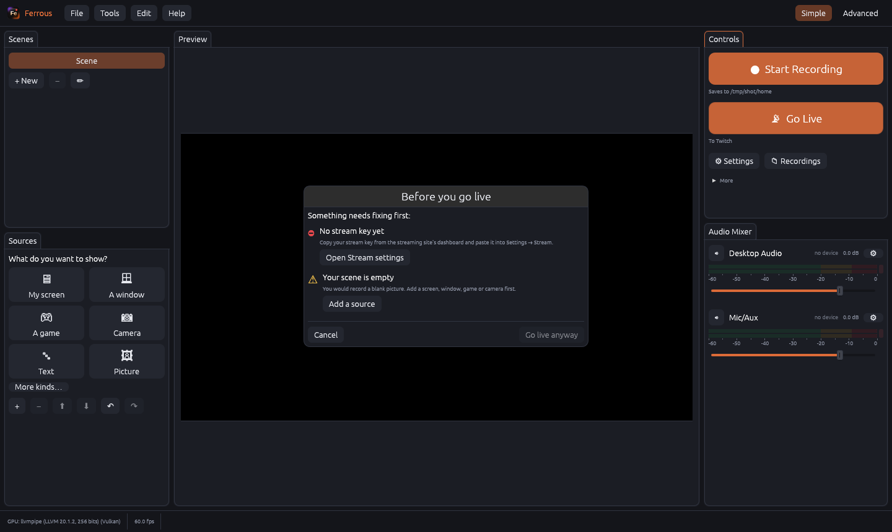 **Pre-flight check**: problems in plain words with one-click fixes | 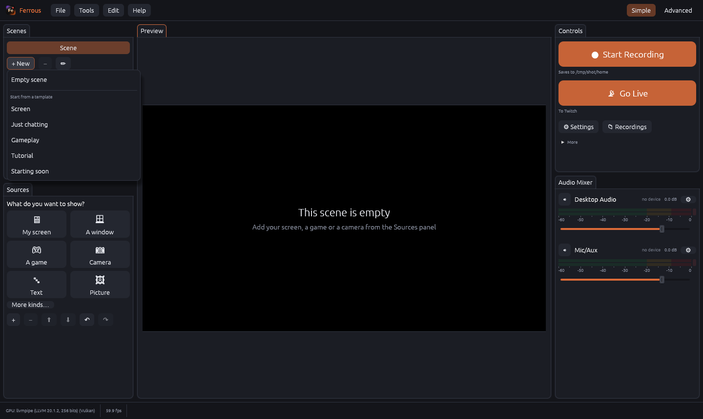 Scene templates: Screen, Just chatting, Gameplay, Tutorial, Starting soon |
| 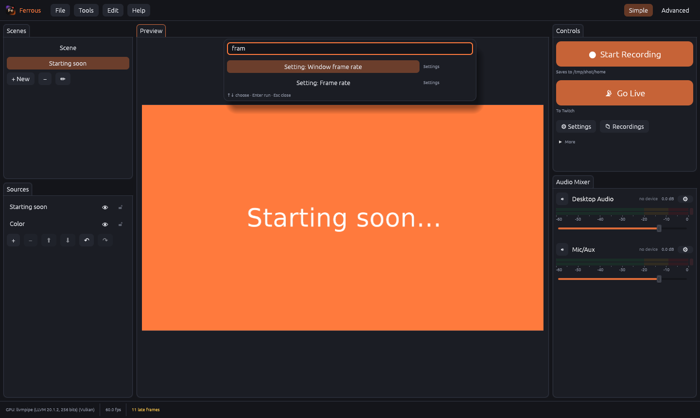 **Ctrl+K** finds any action, scene, source type or setting | 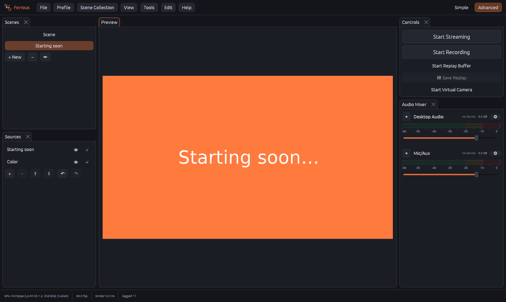 **Advanced mode**: every dock and menu, one click away |
| 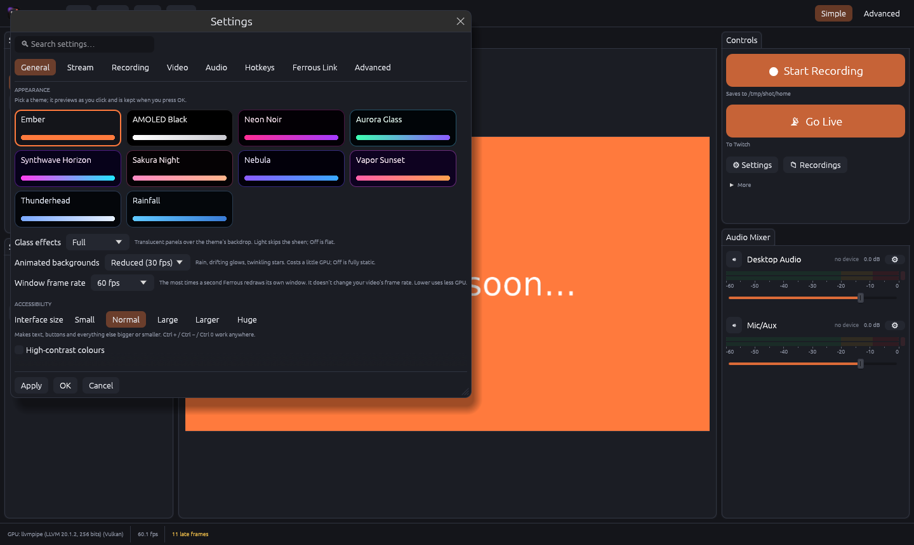 Settings → General: themes and accessibility (interface size, high contrast, colour-blind meters, reduce motion) | 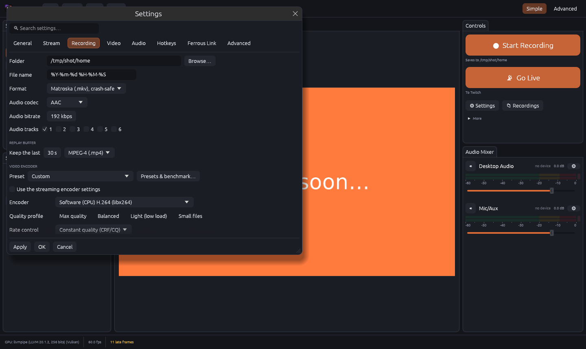 Settings → Recording: quality profiles and presets |
| 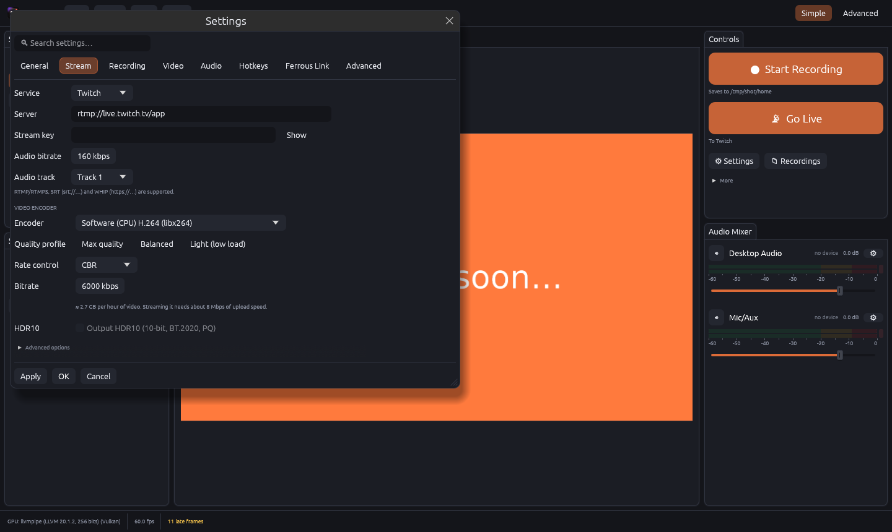 Settings → Stream, with a live "GB per hour / Mbps needed" hint | 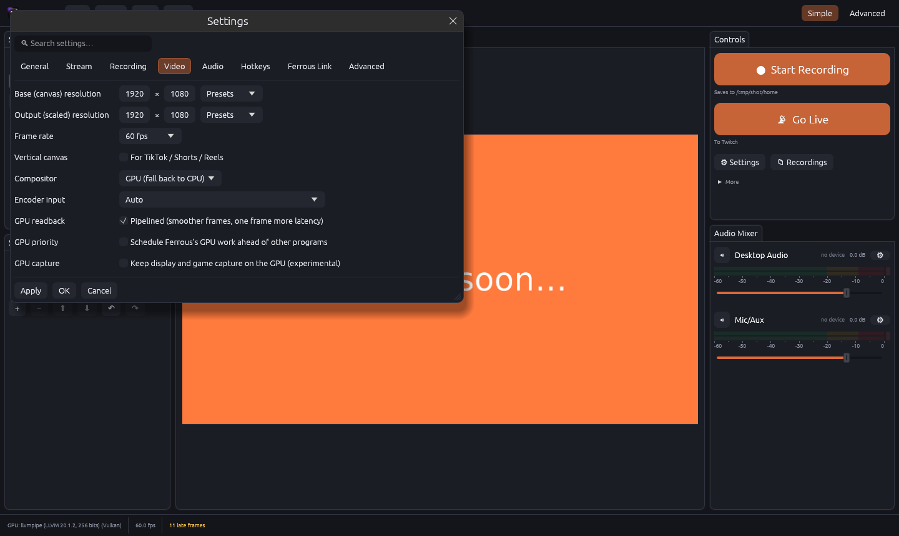 Settings → Video: compositor, GPU readback and priority, experimental GPU capture |
| 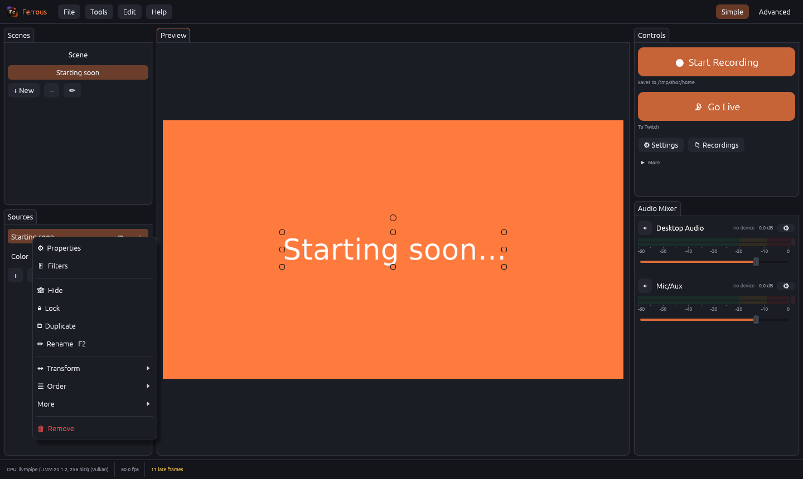 Source right-click menu | 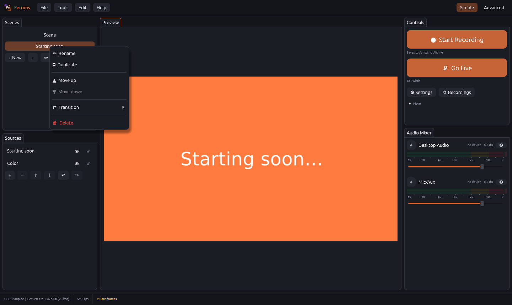 Scene right-click menu |
| 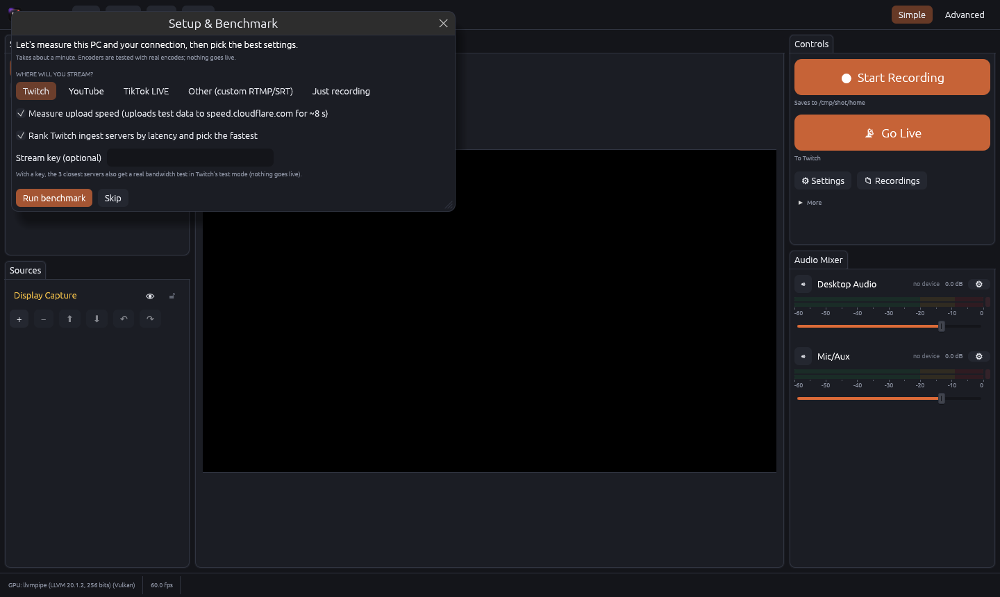 First-run setup and benchmark | |

## Architecture

```
app/                 egui GUI: docks, settings, setup benchmark, wizards, remote-API bridge
crates/
  ferrous-core         scene model, settings, profiles/collections, OBS import, filter configs
  ferrous-capture      sources: WGC, DirectShow/media (FFmpeg), text, browser (CDP), app audio, Link, plugins
  ferrous-render       GPU (wgpu) and CPU compositors, video filters, transitions
  ferrous-audio        WASAPI capture, mixer (6 tracks), audio filters, monitoring
  ferrous-encode       encoder catalog, hardware probe, FFmpeg args, auto-config
  ferrous-output       FFmpeg outputs: record, stream, replay segments, multitrack
  ferrous-engine       render clock, source cache, outputs, destinations, links, perf accounting
  ferrous-link         Ferrous Link sender/receiver, codecs, discovery, encryption
  ferrous-remote       obs-websocket 5 protocol server
  ferrous-plugin-api   stable C ABI for plugins
  ferrous-plugins      plugin loader/host
  ferrous-sysmon       system, process and Windows GPU counters
  ferrous-bench        setup benchmark and ingest ranking
  ferrous-vst3         VST3 host (load, process, parameters, state, editor window)
  ferrous-vcam         virtual camera frame transport and Windows camera control
  ferrous-vcam-source  the camera's Media Foundation source (COM DLL loaded by Windows' Frame Server)
  ferrous-obs          OBS plugin bridge client and protocol
tools/obs-host       ferrous-obs-host: runs OBS plugin sources on the real libobs
plugins/example      example plugin (gradient source, invert filter, gain filter)
plugins/vst3-test-gain  tiny VST3 effect used to test the VST3 host
```

Encoding goes through FFmpeg, the same way OBS uses libavcodec for most of its outputs, which gives
one stable interface to every hardware and software encoder.

## Building

### Option A: GitHub Actions (no local setup)

Push this folder to a GitHub repository. The included workflow (`.github/workflows/windows.yml`)
runs the tests, builds a release `.exe`, bundles FFmpeg (a GPL build with every encoder above) and
uploads `ferrous-windows-x64` as a downloadable artifact.

### Option B: locally on Windows 10 (1903+) or 11

1. Install Rust: <https://rustup.rs> (pick the default MSVC toolchain and install the Visual Studio
   C++ Build Tools when prompted).
2. Get FFmpeg: download `ffmpeg-master-latest-win64-gpl.zip` from
   <https://github.com/BtbN/FFmpeg-Builds/releases>. Put `ffmpeg.exe` next to `ferrous.exe`
   or on your `PATH`, or set its path in Settings > Advanced.
3. Build and run:
   ```
   cargo run --release -p ferrous
   ```
4. Run the tests (the end-to-end recording test needs FFmpeg on `PATH`):
   ```
   cargo test --workspace --release
   ```

Profiles and scene collections are saved to `%APPDATA%\Ferrous`, and plugins go in `%APPDATA%\Ferrous\plugins`. Recordings go to your Videos folder by default.

## What's next

The previous to-do list is done (see "README to-do list" in `docs/PROGRESS.md`). What remains:

- **Run the Windows-only parts on real hardware.** The virtual camera source, VST3 editor windows,
  the D3D12/Vulkan encoders and the OBS host on `obs.dll` all compile for Windows, but haven't run
  on a Windows machine yet.
- **Optional: zero-copy encoding** (the canvas texture straight to the hardware encoder without a trip
  through system memory). It would need an in-process encoder (Media Foundation) instead of FFmpeg's pipe.
  It only matters for 4K60 and very high frame rates; at 1080p/1440p the FFmpeg route is just as fast and
  keeps every tuned encoder option (NVENC multipass, lookahead, AV1, 10-bit HDR10), so it is not planned
  unless those resolutions become a target.
- **OBS plugin filters** through the bridge (sources work today).

## License

GPL-2.0-or-later. This project contains no OBS code. The bundled FFmpeg GPL build is GPL-licensed.
